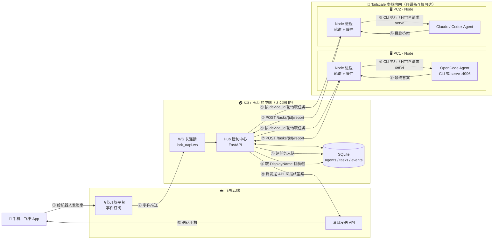

# Networked Agent Remote Control — 设计文档

> 分布式多设备 AI Agent 远程控制系统：通过飞书手机端远程控制多台无公网 IP 电脑上的本地 Agent（OpenCode / Claude / Codex），只返回最终确认答案。

## 1. 需求定义（用户确认版）

1. 多台电脑（PC1、PC2…）各运行不同 Agent，用手机飞书随时下指令，当作 24 小时助手。
2. 每个 Agent 在飞书中是独立机器人身份（如"PC1-OpenCode"、"Mac-Claude 记忆实验"），显示名可随时编辑。
3. 不关心流式输出，只关心最终答案：Agent 答完后返回确认过的最终结果。
4. 电脑无公网 IP，系统必须正常工作。
5. 指令正确路由到对应电脑的对应执行方式（`opencode serve` 端口 / 本地 CLI / 工作目录）。

**已确认决策：**
- 执行引擎：**两种都要，按 Agent 可配置**（默认 `cli` 一次性执行；需要会话记忆的用 `serve` 模式 + 持久 session_id）。
- 组网：电脑**不在同一网络**，Hub↔Node 通过 **Tailscale** 互连。
- IM 范围：**本期只做飞书**，抽象 IM 适配器接口，QQ 后期插拔。

## 2. 架构审计结论（6 处修正）

| # | 修正项 | 说明 |
|---|--------|------|
| 1 | 飞书 **WebSocket 长连接** 收事件（`lark_oapi.ws`） | 无需公网回调 URL，Tunnel 不再必须 |
| 2 | 优先 `opencode run` 一次性 CLI 拿最终答案 | 进程退出=回答结束；serve 模式才需要流式缓冲 |
| 3 | SQLite 任务表代替 Redis | 降运维成本，Node 轮询即可 |
| 4 | 补安全层 | Node token 认证 + 飞书密钥 + 指定用户白名单 |
| 5 | 事件幂等 + 每 Agent FIFO 串行 | 防飞书重发事件、防会话错乱 |
| 6 | 本期只做飞书 | 抽象 FeishuAdapter/QQAdapter |

## 3. 系统架构图



## 4. 数据库结构（SQLite）

```sql
CREATE TABLE devices (                    -- 节点认证
    device_id  TEXT PRIMARY KEY,          -- pc1 / pc2
    name       TEXT NOT NULL,
    token      TEXT NOT NULL,             -- Node 拉任务的认证 token
    created_at TEXT DEFAULT (datetime('now'))
);

CREATE TABLE agents (                     -- 核心映射表：AppID -> 设备 -> 引擎配置
    app_id       TEXT PRIMARY KEY,        -- 飞书应用 AppID，如 cli_a8f7x2
    device_id    TEXT NOT NULL REFERENCES devices(device_id),
    agent_name   TEXT NOT NULL,           -- 内部名：opencode / claude / codex
    display_name TEXT NOT NULL,           -- 可编辑显示名：PC1-OpenCode
    engine_type  TEXT NOT NULL CHECK(engine_type IN ('cli','serve')),
    exec_path    TEXT,                    -- cli: 命令路径；serve: http://127.0.0.1:4096
    work_dir     TEXT,                    -- 工作目录
    session_id   TEXT,                    -- serve 模式持久会话 ID（NULL=每次新建）
    app_secret   TEXT NOT NULL,           -- 飞书应用密钥（发消息用）
    enabled      INTEGER DEFAULT 1,
    created_at   TEXT DEFAULT (datetime('now'))
);

CREATE TABLE tasks (                      -- 任务队列（Node 轮询，无需 Redis）
    task_id      TEXT PRIMARY KEY,
    app_id       TEXT NOT NULL REFERENCES agents(app_id),
    device_id    TEXT NOT NULL,
    prompt       TEXT NOT NULL,
    status       TEXT NOT NULL DEFAULT 'pending'
                 CHECK(status IN ('pending','running','done','failed','timeout')),
    result       TEXT,
    error        TEXT,
    created_at   TEXT DEFAULT (datetime('now')),
    started_at   TEXT,
    finished_at  TEXT
);

CREATE TABLE feishu_events (              -- 事件幂等去重
    event_id    TEXT PRIMARY KEY,
    handled_at  TEXT DEFAULT (datetime('now'))
);
```

## 5. Task 对象结构

```json
{
  "task_id": "t_20260831_0001",
  "app_id": "cli_a8f7x2",
  "device_id": "pc1",
  "prompt": "帮我总结一下这个仓库的架构",
  "engine": {
    "type": "cli",
    "command": ["opencode", "run"],
    "work_dir": "/Users/example/projects/foo"
  },
  "reply": {
    "message_id": "om_xxxxxxxx",
    "open_chat_id": "oc_xxxxxxxx",
    "chat_type": "p2p"
  },
  "status": "pending",
  "created_at": "2026-08-31T12:00:00Z"
}
```

> `serve` 模式下 `engine` 为 `{"type": "serve", "base_url": "http://127.0.0.1:4096", "session_id": null}`；`reply` 字段用于 Hub 拿到结果后回发消息定位原会话。每个 Agent **FIFO 串行**消费（同一 app_id 同时只跑一个任务）。

## 6. 信息流（端到端）

1. 手机飞书向某机器人发消息 → 飞书云端。
2. 飞书经 **WS 长连接** 推送事件到 Hub（无需公网 IP）。
3. Hub 校验签名 → 按 `event_id` 去重 → 查 `agents` 表定位目标 Agent。
4. Hub 建任务入队（SQLite），Node 按 `device_id` 轮询拉取。
5. Node 按 `engine_type` 执行：`cli` 走 `opencode run`；`serve` 走 HTTP + 持久 `session_id`（Node 做流式缓冲）。
6. Node 取到最终答案 → POST 回 Hub。
7. Hub 取 `display_name` 拼 `【DisplayName】` 前缀作为**卡片标题**，正文以飞书**消息卡片**（`msg_type: interactive` + `lark_md`）发送，原生渲染 markdown（粗体/标题/列表/行内代码/代码块）；超长答案按段落拆成多条卡片。实现：`hub/feishu_client.py::reply_card` + `hub/hub.py::reply_final`。
